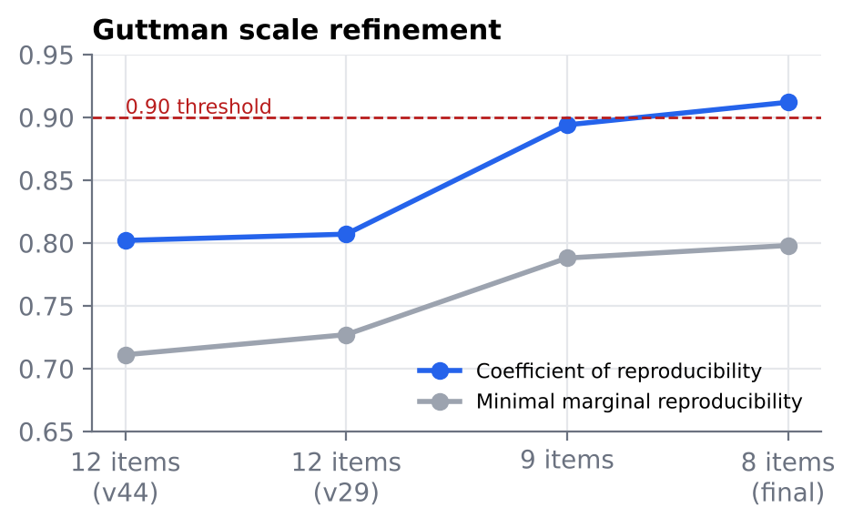
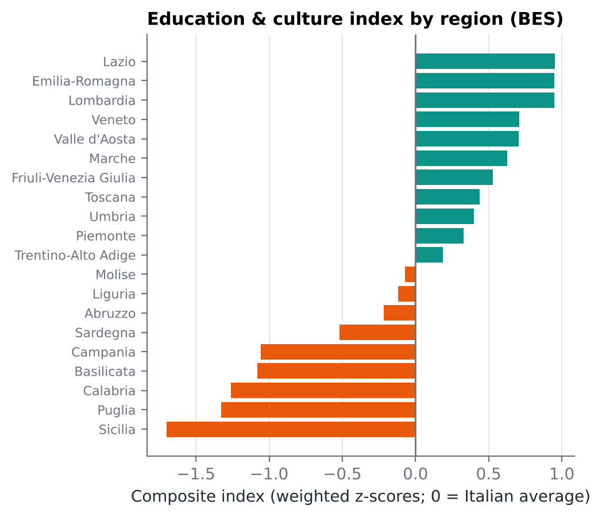

# Survey Design and a Composite Well-Being Index

**Questionnaire design · Guttman scale (CR 0.912) · BES composite index for Italian regions, robust across 5 methods (Kendall's W 0.989)**

📄 [English summary (2 pages)](survey_wellbeing_summary_EN.pdf) · full report in Italian: [`elaborato.pdf`](elaborato.pdf) · [questionnaire](questionario_versione_stampabile.pdf)

## Research questions

The project applies three quantitative tools of social research:

1. **Survey design** — how should a questionnaire be built to evaluate the university catering service at Milano-Bicocca?
2. **Measurement** — can reactive aggression be measured with a cumulative (Guttman) scale, and how does it relate to gender and optimism?
3. **Composite indicators** — how do Italian regions rank on education and culture, and is that ranking robust to the way the index is built?

## Data

- **Part 1:** information on Milano-Bicocca catering services; target population: enrolled students.
- **Part 2:** a 60-item behavioural questionnaire and the LOT-R optimism scale (course dataset).
- **Part 3:** ISTAT BES 2023 (*Benessere Equo e Sostenibile*) regional indicators (education and training, culture) and life-satisfaction data.

## Methods

1. **Questionnaire:** area tree with eight sections, filter questions, four-point ordinal scales without a neutral point, alternated formats to limit response sets.
2. **Guttman scale:** items ordered by intensity, then dropped step by step on scaling errors; coefficient of reproducibility (CR) and minimal marginal reproducibility (MMR); Welch t-tests by gender; Pearson correlation with LOT-R.
3. **Composite index:** seven indicators in five sub-dimensions, z-score standardisation and weighting; robustness across five aggregation methods (ranks, index numbers, min–max, z-scores, shares) via Spearman correlations and Kendall's W; k-means and hierarchical clustering (elbow method).

## Key results

**1. A reliable 8-item scale.** Removing the items with most scaling errors raised the reproducibility from 0.80 to **0.912**, above the conventional 0.90 threshold.

<p align="center"></p>

**2. Aggression and optimism move in opposite directions.** Women score slightly but significantly higher on the aggression scale, mostly on indirect items; aggression is negatively associated with optimism (r = −0.22, 95% CI −0.28 to −0.15).

**3. A robust North–South gradient in education and culture.** All five aggregation methods agree (Spearman > 0.98, Kendall's W = 0.989). Lazio, Emilia-Romagna and Lombardy lead; Sicily, Puglia and Calabria close the ranking; clustering finds three groups of regions. The index is only weakly related to life satisfaction.

<p align="center"></p>

**Limitations.** The questionnaire was not piloted; the Guttman scale relies on self-reported data and is only just above the 0.90 threshold; index weights involve judgement and some BES values were missing.

## How to reproduce

```bash
git clone https://github.com/SofiaMenegozzo/Survey-Design-and-Statistical-Models-and-Composite-Well-Being-Index.git
cd Survey-Design-and-Statistical-Models-and-Composite-Well-Being-Index
```

- **Inspect all results in R:** `load("environment.RData")` restores the datasets and every object created by the analysis (scale, tests, index, clusters).
- **Re-run the script:** `script_R.R` reads its inputs from a `data/` folder (`tavola.csv`, `scalaitem.csv`, `lotR.csv`, `indici.csv`, `soddisfazione_vita.csv`). The respondent-level course data are not published, so this step requires the original files.
- **Composite index without R:** every step of part 3 — standardisation, weighting, the five methods and the comparison with life satisfaction — is in [`indicatore_sintetico.xlsx`](indicatore_sintetico.xlsx).

## Repository contents

| File | Description |
|---|---|
| `script_R.R` | R script for parts 2 and 3 |
| `environment.RData` | Saved R workspace with data and results |
| `indicatore_sintetico.xlsx` | BES data and all composite-index calculations |
| `questionario_versione_stampabile.pdf` | Final questionnaire |
| `survey_wellbeing_summary_EN.pdf` | 2-page summary in English |
| `elaborato.pdf` | Full report (Italian) |
| `grafico_aggiuntivo_*.png`, `figures/` | Dendrogram, elbow plot and charts used in this README |

**Tools:** R · Excel

**Authors:** Sofia Menegozzo, Alessia Cazzulani — Social Statistics course, BSc Statistics and Information Management, University of Milano-Bicocca
